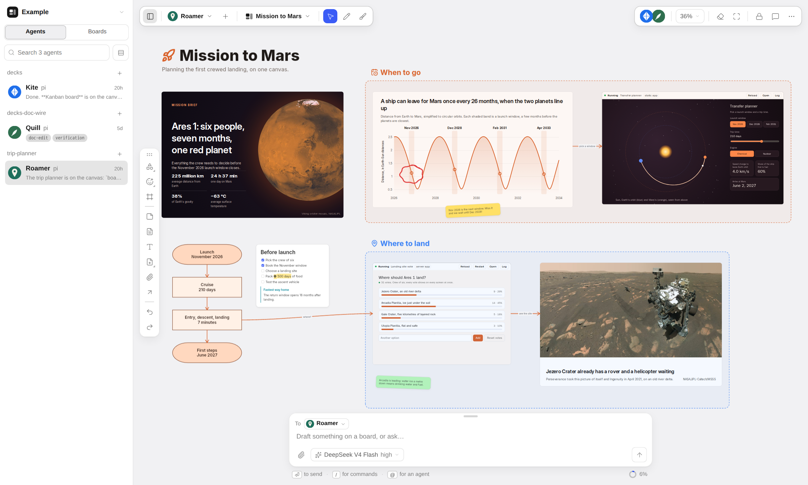

# Decks

**A canvas where you and your AI agents work side by side.** Ask an agent a question and it
answers on a board: a page it designs and places on an infinite canvas you pan and zoom.
Boards stay where they were put, so a plan, a chart or a working app is still there an hour
later, ready for you to edit by hand or to hand to the next agent.

[](https://github.com/DotIN13/decks/actions/workflows/test.yml)



## What it can do

- **Boards are plain HTML files.** Read them, diff them, open them in a browser without Decks.
  Agents write them with their usual tools; you drag, resize and retype them.
- **Draw around them.** Notes, shapes, arrows, icons and frames sit between boards, saved
  as a [pen.dev](https://pen.dev) file that agents edit too.
- **Apps on the canvas.** Ask for a tool, a game or a dashboard and an agent builds it in
  `apps/<name>/`: a single page, a React or Solid build, or a Next.js or Node server that
  Decks runs, wakes and puts to sleep for you.
- **Documents you can write in.** Markdown, LaTeX (with a PDF preview), Word and Google
  Docs open as pages. An agent's edits arrive highlighted, for you to accept or reject.
- **Many agents, five runtimes.** Run agents on [Pi](https://github.com/earendil-works/pi),
  Claude Code, opencode, OpenCode 2 or Antigravity. Each has a name, a face and its own canvas, and
  they can hand work to one another.
- **Your files, in place.** Show PDFs, images, films and source code on a board, or drop
  files from your desktop onto the canvas.
- **Your own browser, shared.** With the Decks extension, an agent can read and fill in a
  Chrome tab you choose to share.
- **Works on a phone or tablet.** Pinch, pan and tap; the panels become sheets.

## How to use it

You need **Node.js 22.19 or newer**, and a model: run `pi auth` once, sign in to Claude
Code, or set `ANTHROPIC_API_KEY` or `OPENAI_API_KEY`. Without one, everything but the agents
still works.

### By hand

```bash
git clone https://github.com/DotIN13/decks.git
cd decks
npm ci
npm run dev                       # then open http://127.0.0.1:4328
```

Your first canvas is empty. Type a request in the box at the bottom and the first board
appears. `npm run dev:example` opens a demo deck instead. Everything you make lives in one
folder (`data/` here, or wherever `DECKS_DATA_DIR` points), so a deck is easy to back up or
move.

To keep it running on a server you reach from a laptop or phone, build it once and run it
as a service:

```bash
npm run build
npm start                         # the app on 127.0.0.1:4329
```

[docs/DEPLOYMENT.md](docs/DEPLOYMENT.md) walks through the rest: a service user, credentials,
systemd, and HTTPS over a private network.

### With an agent

A coding agent such as Claude Code can set Decks up for you. Open it in this folder on the
machine that will run Decks, and paste:

> Deploy Decks on this machine by following docs/DEPLOYMENT.md. Keep it bound to localhost
> and reach it only over a private network such as Tailscale. Ask me before any step that
> needs sudo, and finish by running the checks in section 11.

### Please keep it private

Decks gives its agents a real shell, and the server has no login: anyone who can reach its
port can run code as you. **Bind it to localhost and reach it over a private network**, never
the open internet. [SECURITY.md](SECURITY.md) says more, including how to report a problem.

## Contributing

Ideas, bug reports and pull requests are all welcome. [CONTRIBUTING.md](CONTRIBUTING.md) is
short: it asks for a test that could fail and a comment that says why. `npm test` runs the
unit tests and needs no model; `npm run test:e2e` runs the browser checks.
[docs/DESIGN.md](docs/DESIGN.md) explains why things are the way they are.

## License

MIT. See [LICENSE](LICENSE).

## Citing Decks

If Decks helps your work, we would be glad if you cite it:

```bibtex
@software{decks2026,
  title  = {Decks: a canvas where people and AI agents work side by side},
  author = {DotIN13},
  year   = {2026},
  url    = {https://github.com/DotIN13/decks},
  note   = {Version 0.1.0}
}
```
